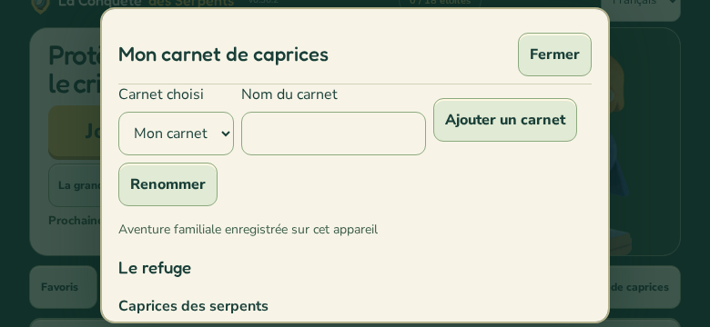
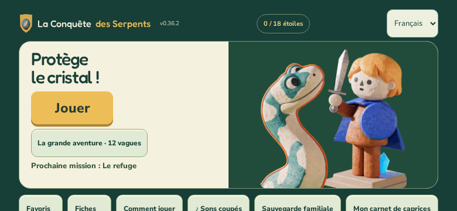
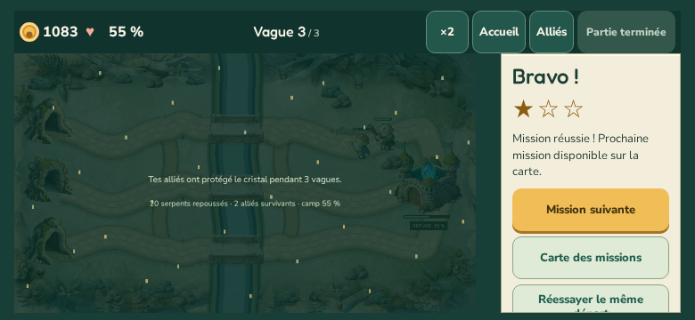

# Audit graphique et menus mobiles — 10 novembre 2026

La priorité est de raccourcir les écrans de préparation et de collection, puis d’unifier les matières. Le jeu possède déjà des figurines utilisables et un dock de combat compact. Une régénération générale des images serait prématurée.

**Statut : audit et propositions avant modification, conformément au choix du parent.** Aucun code, règle, prix, format de sauvegarde ou asset de production n’a changé pendant cette étude. Aucune génération payante lancée. La version jouable reste la **0.36.2**, fusionnée et [publiée](https://conquete-serpents-famille.zyclope.chatgpt.site/), avec son [reçu](../reports/deployment-0.36.2.json). Ce document propose la suite ; il ne prétend pas que la refonte décrite soit réalisée ou validée.

## Ce qui a réellement été regardé

- **12 jeux grand public** : 73 images de galeries officielles inspectées, complétées par des captures documentées. Neuf jeux ont un écran mobile identifiable de titre, carte, sélection, lobby ou pause ; deux apportent une preuve partielle, et Crossy Road seulement un menu TV, exclu des menus tactiles.
- **5 tower defense** : quatre ont des menus/préparations documentés ; pour PvZ2, les preuves couvrent surtout catalogue et combat. Les sources PC, captures promotionnelles, archives et véritables écrans mobiles sont distingués.
- **Notre jeu** : 40 captures fraîches de la version publique, quatre formats, contrôles natifs, puis un contrôle des caprices à petit format et neuf vérifications de portraits. Un complément a ensuite observé une victoire normale actuelle par les commandes natives, sans état de victoire fabriqué. Les deux résultats historiques initiaux restent explicitement étiquetés.
- **Les ressources** : icône source inspectée en premier, 30 fichiers inventoriés dans `src/assets`, atlas et consommateurs de rendu vérifiés. Les captures ne remplacent pas un essai physique S24.

Les références ne constituent pas 17 installations ni 17 sessions jouées. Plusieurs interfaces documentées sont anciennes. Une capture fixe ne prouve jamais l’absence de défilement : **aucun scroll n’a été mesuré dans les jeux de référence**. Les mesures ci-dessous concernent notre application uniquement.

## Diagnostic de notre interface

| Priorité de conception       | Mesure ou preuve actuelle                                                                                                                                                | Proposition, sans ajouter de fonction                                                                                                                                                            |
| ---------------------------- | ------------------------------------------------------------------------------------------------------------------------------------------------------------------------ | ------------------------------------------------------------------------------------------------------------------------------------------------------------------------------------------------ |
| Haute — carnet               | À 780×360, 2 581 px de contenu pour 344 px de fenêtre : environ 7,5 hauteurs visibles. La gestion des noms occupe presque tout le premier écran, avant les autocollants. | Ouvrir sur la collection. Garder le carnet choisi dans un petit en-tête ; déplacer ajouter/renommer dans une commande secondaire. Présenter les 36 cases par mission, avec navigation explicite. |
| Haute — accueil              | Document de 642 px pour 360 px à 780 ; 650/375 à 812. Jouer est visible, mais les raccourcis commencent vers le bas du premier écran.                                    | Réduire l’emprise du diorama, conserver une action dominante et ranger les destinations secondaires dans une bande stable. Préserver l’illustration et les fonctions existantes.                 |
| Moyenne — préparation        | Corps de 781 px pour 261 px à 780 ; les actions fixes restent accessibles. Le raccourci Caprices mène correctement aux cartes.                                           | Résumer mission et équipe, focaliser les choix facultatifs ; conserver le raccourci Caprices et le lancement fixe. Les détails restent accessibles.                                              |
| Moyenne — catalogue          | Panneau de 864 px pour 290 px à 780. Les contrôles consomment une part importante de la première vue.                                                                    | Réduire l’empilement des commandes ; comparer une grille paginée courte à une liste focalisée. Nom, prix, sélection et disponibilité doivent rester immédiatement lisibles.                      |
| Moyenne — matières et cadres | L’icône est volumétrique et mate ; les grandes surfaces HTML paraissent plus plates. Quelques acteurs présentent bois gravé ou métal brillant.                           | Créer un langage de surfaces commun : papier ivoire pressé, vert profond, léger grain, relief mat et ombre cohérente. Texte et libellés restent en HTML/CSS.                                     |
| À conserver                  | Dock de quatre favoris, deux miels et accès à tous les alliés ; pause claire ; fiche compacte en deux colonnes ; actions de préparation de 48 px.                        | Harmoniser leur apparence après la réorganisation des écrans les plus longs. Ne pas reconstruire ces acquis sans bénéfice mesuré.                                                                |

Ces priorités de conception ne sont pas des gravités de bugs techniques. Le carnet fonctionne ; son premier affichage ressemble surtout à un formulaire de gestion.

Sources du produit : [carnet](../src/ui/capriceAlbums.ts), [styles caprices](../src/ui/caprices.css), [styles généraux](../src/style.css), [fiche](../src/ui/unitGuide.css). Les relevés détaillés donnent les lignes et captures dans le dossier de preuves.

### Deux observations à ne pas transformer en faux bugs

À 568×320 avec certaines marges et certains états débloqués, les premières cartes peuvent n’exposer initialement que 19 px. Le panneau entier défile : les captures après geste montrent des cartes complètes et sélectionnables. C’est une limite de découverte, pas un recrutement impossible.

Les portraits initialement vides sur quelques captures de fiche apparaissent après décodage réel des images. Neuf cas accueil/plateau/mobile/ordinateur ont été contrôlés : aucun portrait durablement absent établi. Cette suspicion a été retirée avant le bilan.

### Cadre et téléphone

Trois sujets différents sont à traiter ensemble : la bordure visuelle des panneaux, le raccord du décor autour du plateau, et les marges qui protègent les commandes système Android. Une bordure plus décorative ne doit pas retirer de surface utile ni pousser les boutons sous la barre du téléphone.

L’audit récent utilise les marges simulées du scénario existant, haut 12 / droite 16 / bas 8 / gauche 16 px. Le cas des 19 px provenait d’un autre scénario, haut 24 / droite 48 / bas 16 / gauche 0. Ne pas comparer directement ces positions comme s’il s’agissait du même état ou du S24 physique.

## Comparaison des jeux grand public

Les liens de boutique identifient les jeux et leurs galeries. Les captures complémentaires, leurs dates, leurs URL et leurs empreintes sont dans les rapports bruts du paquet de preuves.

| Jeu et source officielle                                                               | Écran réellement documenté / limite                                                                                                       | Principe utile                                                                                              |
| -------------------------------------------------------------------------------------- | ----------------------------------------------------------------------------------------------------------------------------------------- | ----------------------------------------------------------------------------------------------------------- |
| [Candy Crush Saga](https://apps.apple.com/us/app/candy-crush-saga/id553834731)         | Carte de niveaux dans galerie officielle.                                                                                                 | Séparer sélection centrale et navigation basse. Le chemin vertical n’est pas une preuve de « zéro scroll ». |
| [Royal Match](https://apps.apple.com/us/app/royal-match/id1482155847)                  | Accueil avec scène centrale, boutons de niveau et tâches, bande basse.                                                                    | Action principale visible et zones stables. Éviter deux actions concurrentes de même poids.                 |
| [Angry Birds 2](https://apps.apple.com/us/app/angry-birds-2/id880047117)               | Carte publiée par le [support Rovio](https://roviosupport.helpshift.com/hc/en/10-angry-birds-2/faq/2419-new-energy-system-in-world-map/). | Départ ancré en bas, retour explicite, contexte central.                                                    |
| [Cut the Rope](https://apps.apple.com/us/app/cut-the-rope-physics-puzzle/id1024506959) | Pause iPhone archivée dans un document de 2015.                                                                                           | Panneau court et commandes textuelles de même forme.                                                        |
| [Fruit Ninja](https://apps.apple.com/us/app/fruit-ninja/id403858572)                   | Sélection de modes archivée ; version et date non certifiées.                                                                             | Regrouper visuellement les choix, sans reprendre la constellation de cadenas.                               |
| [Subway Surfers](https://apps.apple.com/us/app/subway-surfers/id512939461)             | Titre iPad de 2013, distinct du support actuel.                                                                                           | Personnage central et entrée simple ; référence de composition ancienne uniquement.                         |
| [Crossy Road](https://apps.apple.com/us/app/crossy-road/id924373886)                   | Menu Android TV du support officiel ; mobile non vérifié.                                                                                 | Alignement de grandes cibles ; ne pas en déduire une ergonomie tactile.                                     |
| [Alto’s Adventure](https://apps.apple.com/us/app/altos-adventure/id950812012)          | Titre iOS paysage de 2015.                                                                                                                | Une action dominante, paysage calme et secondaires discrets. Garder de vrais libellés contrastés.           |
| [Monument Valley](https://apps.apple.com/us/app/monument-valley/id728293409)           | Sélection de chapitre dans un montage communautaire ; Android probable, non certifié.                                                     | Focaliser le choix sur une carte cohérente. Les symboles seuls seraient trop opaques ici.                   |
| [Brawl Stars](https://apps.apple.com/us/app/brawl-stars/id1229016807)                  | Lobby mobile archivé de 2018.                                                                                                             | Personnage, choix courant et démarrage réunis ; ne pas importer la densité d’offres.                        |
| [Clash of Clans](https://apps.apple.com/us/app/clash-of-clans/id529479190)             | Carte et sous-menu de construction officiels ; preuve partielle d’accueil.                                                                | Regrouper les outils contextuels, sans copier son hub dense.                                                |
| [Super Mario Run](https://apps.apple.com/us/app/super-mario-run/id1145275343)          | Hub de royaume officiel, partiellement masqué par un habillage promotionnel.                                                              | Séparer scène et compteurs. Les zones de lancement non visibles restent inconnues.                          |

Le motif utile est la hiérarchie des tâches, pas la surenchère de boutons ni les systèmes de rétention de ces jeux. Aucun magasin, compte en ligne, énergie, publicité ou récompense supplémentaire n’en découle.

## Comparaison tower defense

| Jeu                                                                                           | Preuve de menu / préparation                                                                                                                                                       | Adaptation possible de l’interface existante                                                                                    |
| --------------------------------------------------------------------------------------------- | ---------------------------------------------------------------------------------------------------------------------------------------------------------------------------------- | ------------------------------------------------------------------------------------------------------------------------------- |
| [Kingdom Rush Frontiers](https://apps.apple.com/us/app/kingdom-rush-frontiers-td/id598581396) | [Parcours illustré de 2015](https://addictedgamewise.com/kingdom-rush-frontiers-reference-theft/) : titre, carte, fiche mission, héros, victoire. Plateforme exacte non vérifiée.  | Un départ dominant, une fiche mission courte et un résultat centré sur la suite.                                                |
| [Bloons TD 6](https://apps.apple.com/us/app/bloons-td-6/id1118115766)                         | [Archive UI](https://interfaceingame.com/games/bloons-td-6/) : cartes paginées, difficulté et victoire ; présence de curseur, pas preuve Android. Galeries iPad et Steam séparées. | Quelques cartes lisibles par page, pagination explicite et résumé de résultat court. Aucun nouveau mode à importer.             |
| [Plants vs. Zombies 2](https://apps.apple.com/us/app/plants-vs-zombies-2/id597986893)         | Catalogue promotionnel et [combat documenté](https://arcadewarfare.wordpress.com/2016/11/20/plants-vs-zombies-2-detailed-guide/) ; accueil et vraie préparation non vérifiés.      | Silhouette, nom, prix et disponibilité placés de façon constante sur les cartes.                                                |
| [Arknights](https://apps.apple.com/us/app/arknights/id1464872022)                             | [Guide iPhone de 2022](https://note.com/utacoma/n/n9b5c97216918) : carte, équipe sur deux rangées et départ ; accueil officiel en composite.                                       | Séparer composer et combattre, montrer une fiche contextuelle à la fois.                                                        |
| [Infinitode 2](https://apps.apple.com/us/app/infinitode-2/id1480178308)                       | [Revue mobile de 2021](https://hakuzo.blogspot.com/2021/11/infinitode-2.html) : accueil, grille de niveaux, fiche et Play. Steam identifié comme PC.                               | Une sélection focalisée avec action fixe ; garder ses petites statistiques et son arbre de recherche hors de notre proposition. |

Les preuves de résultats des références les plus complètes sont Kingdom Rush et Bloons. Un complément ciblé a depuis vérifié **notre résultat normal 0.36.2**, à 780×360 avec les mêmes marges : première mission, trois vagues, armée de départ, vitesse ×2 choisie avec le vrai bouton, trois lancements natifs. Une seule partie automatisée, parcours complet d’environ 54,6 s, une étoile et cristal à 55 %. Ce parcours UI ne constitue pas une mesure d’équilibrage ou de plaisir humain.

Le panneau mesure 290 px utiles pour 321 px de contenu : « Mission suivante » jaune (48 px) et la carte des missions sont entièrement visibles dès l’ouverture. Seul Réessayer demande jusqu’à 31 px de défilement. **Cette victoire normale ne justifie pas une priorité forte de refonte du résultat.** Les résultats de caprice et de défaite restent non vérifiés actuellement ; ne pas généraliser à partir de ce seul état.

## Direction artistique et ressources déjà fournies

L’[icône Magnific source](resources-2026-11/assets/icone-source.png) reste la référence : volumes arrondis, matière mate de pâte/papier mâché, crème, vert sarcelle, ocre et bleu, lumière douce du haut/gauche. La caméra basse du portrait ne devient pas celle du plateau, qui a besoin d’une vue haute lisible.

| Famille                                 | Traitement conseillé                                                                                                                 |
| --------------------------------------- | ------------------------------------------------------------------------------------------------------------------------------------ |
| Dinosaures, mutants, bébé dragon, miels | Conserver les formes : elles sont déjà proches de la DA et reconnaissables.                                                          |
| Héros et massue                         | Comparer une retouche de matière à l’icône : visage/bras moins bois gravé, volumes plus doux. Préserver identité et silhouette.      |
| Élites et serpents mécaniques           | Matifier localement le métal et harmoniser l’éclairage.                                                                              |
| Serpents organiques et boss             | Conserver formes, collerette, noir du mamba et trois têtes ; simplifier certains détails si leur lecture à petite taille l’exige.    |
| Trois sols et accessoires               | Garder les centres calmes et les positions ; revoir raccords, répétitions et ombres. Aucun nouvel obstacle ni déplacement des ponts. |
| Panneaux et boutons                     | Relief de papier pressé, grain discret, mêmes coins/ombres/marges. Libellés nets et traduisibles hors des images générées.           |

**Inventaire vérifié :** 30 fichiers dans `src/assets`, dont 25 images ; 19 images importées par `art.ts`. L’atlas `terrain-props` est déclaré mais aucun consommateur de rendu courant n’a été trouvé : import ne signifie pas affichage. Les anciens sols et deux PNG historiques sont conservés, sans justifier de nouvelles commandes graphiques.

**Les ressources de l’audit précédent sont bien prises en compte.** L’icône est intégrée à l’accueil et à Android. Les terrains crue/marais sont utilisés depuis 0.34 comme cadres périphériques, après dérivation ; leur centre trop détaillé n’a pas remplacé le sol jouable. Les trois maquettes et la bannière de capture 0.26 restent des références, sans usage runtime constaté. Leur présence dans le dossier ne vaut pas validation de leur style. Voir la [provenance](resources-2026-11/PROVENANCE.md).

## Outils vérifiés et proposition de comparaison

Les connexions actuelles répondent. Higgsfield expose bien la génération d’images fixes PNG avec fond transparent, GIF/SVG et un outil AutoSprite de planches animées ; ses possibilités ne se limitent pas à la vidéo. Magnific propose génération guidée par référence, retouche et préparation d’images. Runway est authentifié et expose plusieurs générateurs d’images et le détourage. Il s’agit de capacités annoncées par les outils ; aucune nouvelle qualité d’image n’a été testée ici.

Je recommande un **seul banc d’essai comparable** : même héros de référence et même petit élément de décor, trois fournisseurs, mêmes contraintes de caméra/lumière/matière. On compare ensuite les sorties à leur taille réelle, 32–60 px, avant de retenir un outil par famille. Une éventuelle animation vient après validation de l’image fixe.

| Préflight gratuit du 10 novembre                                                           | Estimation obtenue                                             | Limite                                                                                                                       |
| ------------------------------------------------------------------------------------------ | -------------------------------------------------------------- | ---------------------------------------------------------------------------------------------------------------------------- |
| Magnific : une image 1K, une référence existante, qualité standard de la route recommandée | **50 crédits Magnific**, estimation exacte pour ces arguments. | Génération seule ; détourage et éventuelle retouche à chiffrer séparément.                                                   |
| Higgsfield : un PNG 1K, qualité medium, fond transparent                                   | **0,5 crédit Higgsfield**, préflight sans soumission de job.   | Paramètres de base sans média importé ; confirmer les arguments complets du pilote.                                          |
| Runway                                                                                     | Pas de prix par appel exposé par les outils consultés.         | Ne pas convertir le tarif API ou une autre monnaie en prix de cet abonnement. Devis à compléter avant un engagement chiffré. |

Ces crédits appartiennent à des échelles distinctes : ce n’est ni un total en euros ni une facture. **Coût de génération de cet audit : zéro appel payant.** Aucun lot complet de régénération n’est lancé ni budgété à partir de ces deux seules estimations.

Critères du futur essai : fidélité à l’icône, silhouette à petite taille, matière mate, éclairage, fond propre/alpha, absence de halo, absence de texte parasite, recadrage, lisibilité sur nos trois sols et compatibilité des états sélectionné/désactivé. Un atlas entier régénéré sans contrôle risquerait de déplacer les cellules : préparer d’abord des éléments individuels et conserver les contrats du rendu.

## Deux approches à arbitrer avant toute modification

**A — Accueil compact et vues courtes, recommandée.** Une action principale contextuelle ; accès courts à missions, carnet, favoris et réglages existants. La préparation garde son départ fixe. Le carnet ouvre sur les autocollants d’une mission, avec navigation explicite entre les six missions ; la gestion du nom devient secondaire. Le catalogue garde des cartes lisibles et des repères stables. Avantage : tâches plus compréhensibles, moins de longues piles. Coût : réorganiser plusieurs contrôleurs HTML/CSS et vérifier tous les retours/focus.

**B — Plateau comme centre et panneaux superposés.** Revenir plus souvent directement au terrain, puis ouvrir les commandes et collections autour de lui. Avantage : immersion immédiate et moins de transitions d’écran. Coût : davantage d’occlusion du plateau et de gestion modale ; risque de repérage accru pour les petits. Cette approche demande aussi une validation du confort sur le téléphone.

Les deux restent dans la DA approuvée et réutilisent les mêmes fonctions. Ce sont des propositions, pas de nouveaux comportements validés.

## Ordre proposé et critères de réussite

1. **Accueil et carnet**, avec assets existants : action principale et première collection visibles dans le premier écran ; aucune fonction parentale perdue ; cibles d’au moins 48 px.
2. **Préparation et catalogue** : départ/retour toujours visibles ; tous les caprices, copains, prix et descriptions accessibles ; même contenu et mêmes règles, sans simple réduction de police.
3. **Essai graphique borné**, puis retouches retenues : matériaux/cadres avant production de dizaines d’images ; contrôle des silhouettes au format réel.
4. **Recette finale** : 1280×800, 812×375, 780×360 et petit format avec marges ; FR/EN ; anciens départs ; sauvegardes et reprise ; Android physique et navigation système à confirmer.

Le budget de temps/scroll est une **cible de conception à mesurer**, pas un résultat actuel. Un écran de collection peut paginer ; interdire tout défilement rendrait certains libellés ou réglages moins accessibles. Les écrans principaux devraient tenir dans leur zone utile, et le défilement restant être local, explicite et réservé aux détails.

Garde-fous : séparation règles/rendu/interface ; sauvegardes et anciens codes préservés ; noms et annonces des caprices du fils inchangés et en français ; trois voies et leur géométrie conservées ; contours fonctionnels ennemis/alliés ; aucun SDK, nouvelle mécanique, mode, monétisation ou extension de campagne.

Le parent a choisi **audit et propositions avant modification**. La suite attend donc son arbitrage sur la refonte proposée et peut être contre-examinée par Claude avec le [brief joint](archive/POUR-CLAUDE-AUDIT-VISUEL-2026-11-10.md).
