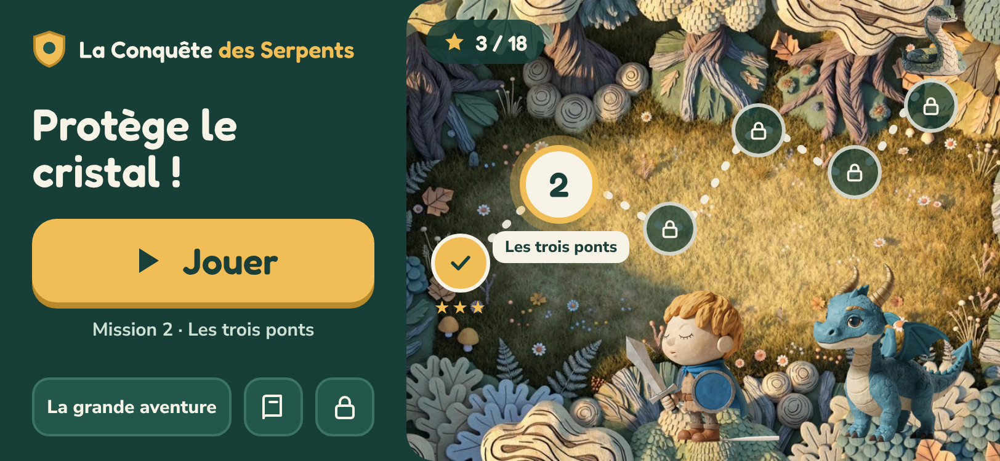
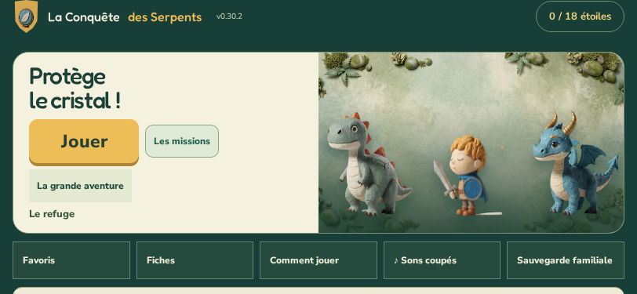
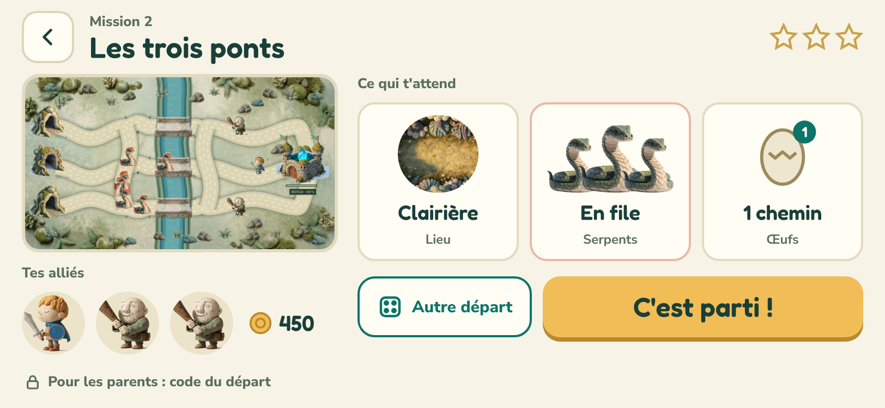
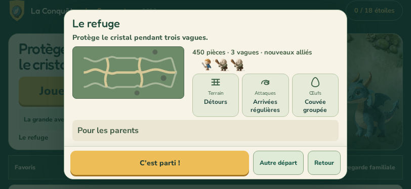
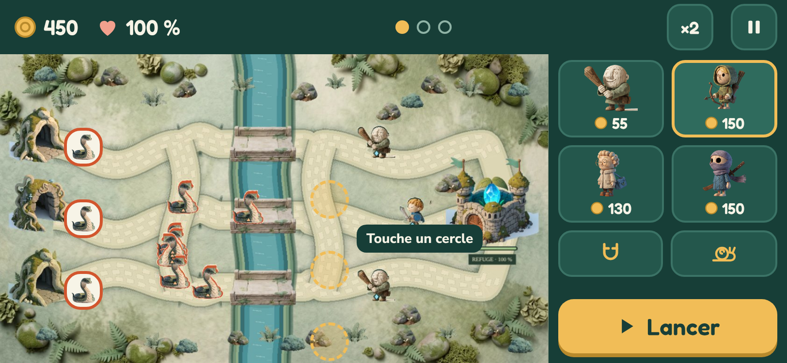
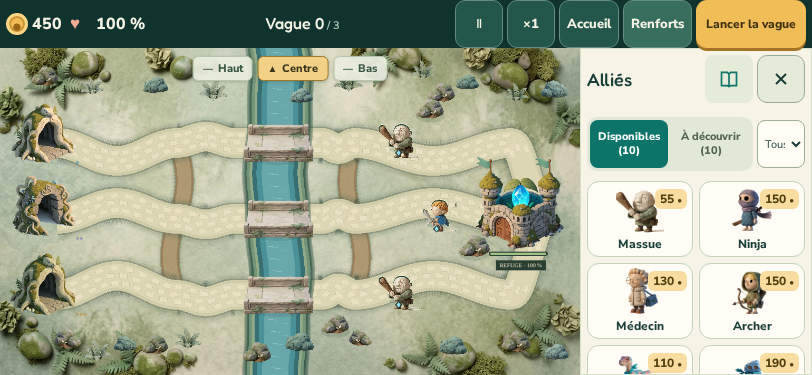

# Audit d'origine et situation réelle — 0.30.2

Analyse du 8 novembre 2026, sur le code `a57b05a`. Demande du parent : reprendre
l'audit fourni et chacun de ses lots, vérifier les images et identifier les
oublis possibles du suivi. Aucun changement de gameplay ni d'image pendant cette
analyse. Le plan courant est rectifié dans [PLAN-ACTUEL.md](../PLAN-ACTUEL.md).

## Conclusion

**Oui, le résumé du plan avait perdu du périmètre.** Les lots 1 et 3 sont
réalisés. Les lots 2 et 7 sont partiels ; appeler « lot 7 livré » la livraison du
seul tutoriel était trop large. Les sous-parties restantes étaient parfois
encore écrites dans un ancien cadrage, mais n'apparaissaient plus au bon endroit
dans le suivi courant. Les images sont conservées, mais plusieurs ne sont pas
utilisées par l'application.

Trois cas doivent rester distingués :

1. **Décisions explicitement remplacées** : garder trois voies visibles dès la
   mission 1 ; abandonner l'achat de déblocage au profit du modèle gratuit choisi.
   Il ne faut pas rétablir l'ancien audit contre ces décisions.
2. **Travaux réellement en attente** : mesures Android physiques, disponibilité
   progressive des outils, Facile, langues, terrains/météo, services commerciaux.
   Un report justifié n'est pas une réalisation.
3. **Éléments sortis du suivi ou trop résumés** : prévision des ennemis aux
   antres, appel anticipé/bonus, dock de quatre favoris, parcours direct du miel,
   fidélité graphique des maquettes et certains textes. Ils sont réinscrits.

Le prochain lot ne doit donc plus être choisi sur la prémisse « tout le travail
enfant/interface est fini ». Les langues restent utiles, mais plusieurs textes
et parcours susceptibles d'être traduits ne sont pas encore stabilisés.

## Sources et méthode

- [Rapport complet fourni](../audit-source-2026-11/originaux/rapport-complet.md),
  [résumé](../audit-source-2026-11/originaux/resume-du-zip.md),
  [plan](../audit-source-2026-11/originaux/plan-du-zip.md) et neuf fiches du ZIP.
- Décisions du parent dans la conversation, GAME_DESIGN, cadrage de novembre,
  propositions et bilans de livraison. Une recommandation jointe ne vaut pas un GO.
- Lecture du code, des tests, des ressources et de leurs empreintes. Trois revues
  parallèles en lecture seule : lots applicatifs, ressources, technique/autres lots.
- Audit strict relancé sur le build de production 0.30.2, captures actuelles à
  812×375 et 1280×800, vérification du message après lancement et inspection des
  trois PNG HD via leur affichage dans le navigateur, sans modifier les sources.
- Suite native relancée par un relecteur : **400/400**. Le workflow GitHub
  [42494670333](https://github.com/zyclope0/snakeattak/actions/runs/42494670333),
  portant sur `a57b05a`, est **entièrement vert** : compilation, tests natifs,
  audit des dépendances runtime, navigateur, interruptions, fichiers embarqués
  sans réseau, quatorze scènes de présentation et portable.

Les originaux textuels et quatre captures du ZIP sont désormais archivés sans
modification avec [manifestes d'empreintes](../audit-source-2026-11/manifest.json).
Les maquettes et HD déjà conservés ne sont pas dupliqués. Avant cette analyse,
le dépôt seul ne permettait pas de retrouver le rapport complet et les neuf
fiches ; leur conservation hors dépôt était documentée, mais fragilisait le suivi.

## État des neuf lots, sans confondre préparation et livraison

| Lot                               | État corrigé                                                | Ce qui est réalisé                                                                                                                             | Ce qui manque ou reste à décider                                                                                                                                                |
| --------------------------------- | ----------------------------------------------------------- | ---------------------------------------------------------------------------------------------------------------------------------------------- | ------------------------------------------------------------------------------------------------------------------------------------------------------------------------------- |
| **1 — Affichage**                 | **Réalisé**, recette physique restante                      | Remontée de page, plateau entier, pied fixe de préparation, cibles HUD, victoire adaptée, contrôle vide supprimé, contrastes signalés corrigés | Confirmer les correctifs de marges système sur le S24 ; pas de certification globale d'accessibilité                                                                            |
| **4 — Android réel**              | **Partiel**                                                 | APK, signature identique, fichiers embarqués, paysage, marges système, catalogue adjacent, diagnostic local, reprise corrigée                  | Mission 6 et vague 12 mesurées sur téléphone : FPS, chargement, mémoire ; veille, appels, navigation système, destruction/reprise                                               |
| **3 — Plateau**                   | **Réalisé**                                                 | Raccords à 60 % de largeur, terre sous les voies, halos nettoyés, original et script reproductible conservés                                   | Conserver ces acquis ; cela n'intègre pas les deux nouveaux fonds                                                                                                               |
| **2 — Lisibilité**                | **Partiel**                                                 | Jouer vers la prochaine mission, commandes secondaires, préparation raccourcie, code côté parents, beaucoup moins de texte initial             | Français encore imparfait, vocabulaire, introduction des outils réservée, parcours miel, finition graphique des maquettes ; autonomie réelle d'enfant peu lecteur non démontrée |
| **7 — Tutoriel, signaux, Facile** | **Tutoriel réalisé ; lot complet partiel**                  | Trois voies visibles, ennemis centre→deux→trois ; masque commun aux œufs et jonctions ; anciens codes conservés                                | Prévision des ennemis absente ; appel anticipé/bonus non défini ; Facile absent ; dock permanent de quatre alliés absent                                                        |
| **8 — Modèle économique**         | **Ancienne proposition remplacée ; nouveau modèle préparé** | Décision gratuite/pub rare/suppression/cosmétiques et limites consignées                                                                       | Aucun SDK, publicité, achat, portail commercial, reçu, restauration ou remboursement intégré/testé                                                                              |
| **9 — Publication**               | **Préparé, pas livré au store**                             | Brouillons, outil de contrôle, procédure, six captures et une bannière                                                                         | Identité en attente, identifiant final, icône/native, documents exacts selon futurs SDK, AAB, tests et validations ; captures encore 0.30.1                                     |
| **5 — Langues**                   | **Non commencé dans l'application**                         | Fiches store en quatre langues seulement                                                                                                       | Catalogues FR/EN/DE/IT, extraction, choix mémorisé, pluriels/nombres, contrôles allemands, relecture humaine                                                                    |
| **6 — Lieux/événements**          | **Ressources conservées ; non implémenté**                  | Deux fonds HD récupérés et inspectés, provenance/empreintes                                                                                    | Exports et intégration des fonds, validation du marais ; météo, codes et équilibrage à valider séparément ; report après sortie conservé jusqu'à nouvel arbitrage               |

Il n'y a pas de pourcentage global fiable à déduire de ce tableau : les lots ont
des tailles différentes et certains sont soumis à une décision, d'autres à une
mesure matérielle ou à de la réalisation.

## Vérification des exigences des lots 1, 2 et 3

| Exigence de l'audit                                                       | Résultat vérifié                                                                                 | Référence utile                                                                     |
| ------------------------------------------------------------------------- | ------------------------------------------------------------------------------------------------ | ----------------------------------------------------------------------------------- |
| Revenir en haut après lancement/reprise/classique/code                    | Réalisé                                                                                          | `src/main.ts`, `scripts/display-027-browser.mjs`                                    |
| Plateau entier aux trois tailles ordinateur, interface supérieure ≤120 px | Réalisé : top 117 px, bas dans la fenêtre                                                        | [Audit actuel](../../reports/reconciliation-audit-0.30.2/interface-audit.json)      |
| Lancement visible avant défilement à 1280×800 et 812×375                  | Réalisé, y compris objectif long                                                                 | Pied de dialogue et recette `display-027`                                           |
| HUD tactile ≥48×48 px, cadre vide retiré                                  | Réalisé en navigateur                                                                            | `index.html`, `src/style.css`, recette mobile                                       |
| Victoire adaptée au nombre réel de vagues                                 | Réalisé                                                                                          | `src/render/resultCopy.ts`, tests `result-copy-027`                                 |
| Quatre contrastes de l'accueil                                            | Corrigés et contrôlés à la livraison ; pas un audit global de tous les états                     | `docs/BILAN-0.27.md`, recette axe de `display-027`                                  |
| Un seul vocabulaire des unités, tutoiement partout                        | Partiel : « Renforts », « soldats », et « défendez le camp » subsistent                          | `index.html:384`, `src/ui/coaching.ts:51`, `src/ui/childCopy.ts`, `src/game.ts:464` |
| Gros Jouer, prochaine mission non terminée, secondaires                   | Réalisé                                                                                          | `src/ui/expeditions.ts`, `index.html`, recette lisibilité                           |
| Préparation : trois cartes, libellés courts, code replié, pied fixe       | Minimum fonctionnel réalisé ; carte SVG et pictogrammes, pas la composition riche de la maquette | [Capture actuelle](../../reports/reconciliation-audit-0.30.2/preparation-812.png)   |
| Dé « Autre départ »                                                       | Tirage réalisé ; pictogramme dé non repris                                                       | `index.html:268`, `createMissionRun`                                                |
| Miel2, Encourager3, Réparer4, héros5                                      | Non réalisé, réservé comme changement de disponibilité                                           | `docs/PROPOSITION-LOT-7.md`, `src/ui/adventureControls.ts`                          |
| Deux grosses icônes de miel, puis toucher la voie                         | Pots présents ; choix encore par trois boutons textuels ; pas de geste sur le plateau            | `src/ui/feastControls.ts`, `BattleScene.pointerdown`                                |
| ≤60 mots avant vague 1 à 1280×800                                         | 47 mots DOM dans les parcours actuels testés ; cible satisfaite                                  | [Captures et mesure](../../reports/reconciliation-audit-0.30.2/captures.json)       |
| Enfant peu lecteur autonome                                               | Pas démontré par ces chiffres                                                                    | Essai familial guidé à organiser, sans confondre avec avis favorable sur le jeu     |
| Raccords 40 % plus étroits, sous les voies, en terre                      | Réalisé                                                                                          | `src/render/refinedTerrain.ts`, bilan 0.28                                          |
| Halos retirés, source et procédé conservés                                | Reproduction `--check` réussie : 22 249 pixels, dont 19 604 opaques                              | `scripts/clean-strongholds.py`, `strongholds.original.webp`, provenance runtime     |

Le script d'audit recherche seulement `vous/votre/vos` avant la première vague.
Il passe donc « zéro vouvoiement » tout en manquant **« Vague 1 : défendez le
camp ! »** après lancement, confirmé aussi dans le DOM actuel. Le message reste
dans des données historiques et `childCopy` ne transforme pas cet impératif.
La correction devra porter sur la présentation, sans casser les instantanés du
moteur. Ce défaut n'a pas été corrigé pendant la présente analyse.

La cible de 60 mots est un critère d'interface borné : le compteur exclut le
canvas et les panneaux repliés ou hors zone visible. 13/13 ne signifie donc ni
« huit mots partout », ni « tous les lots terminés », ni « compréhension enfant ».

## Périmètre exact du lot 7 à restaurer

| Sous-partie                                                    | État                                           | Suite légitime                                                                                                              |
| -------------------------------------------------------------- | ---------------------------------------------- | --------------------------------------------------------------------------------------------------------------------------- |
| Une seule voie visible jusqu'à mission 2                       | Proposition originale remplacée                | Ne pas la rétablir : le choix du fils conserve les trois voies                                                              |
| Centre→deux→trois au nouveau Refuge                            | Livré 0.30                                     | Garder le masque commun et les règles historiques versionnées                                                               |
| Un seul allié supplémentaire en mission 1                      | Non retenu dans le cadrage                     | Ne pas restreindre automatiquement les dix types actuellement proposés                                                      |
| Prochain ennemi annoncé à chaque antre                         | Absent et perdu du résumé courant              | Concevoir une prévision honnête des menaces, sans consommer le RNG ni figer l'IA                                            |
| Appel anticipé + bonus proportionnel au temps gagné            | Absent ; règle réservée                        | Définir d'abord ce que serait le temps gagné dans une préparation actuellement sans décompte                                |
| Facile combinant vie/prix/vitesse, choisi en pause et mémorisé | Absent ; valeurs et fonctionnement non validés | Proposition distincte au parent/fils, simulations sur six missions et migration prévues                                     |
| Quatre alliés toujours visibles, deux miels directs            | Pas livré comme la maquette                    | Le catalogue adjacent 0.30.1 évite le recouvrement, mais se ferme après sélection ; arbitrage dock/raccourcis encore ouvert |
| Gros Lancer et aides de placement                              | Réalisé                                        | Conserver le placement libre ; ne pas transformer les cercles en emplacements obligatoires                                  |

Les **648 simulations** comparent ancien/nouveau Refuge avec trois politiques et
six graines réutilisées par configuration. Elles ne sont ni un test Facile/Normal
sur six missions ni un test de plaisir. Les deux versions gagnaient déjà toutes
les parties simulées ; le minimum novice passe même de 64 % à 55 % de cristal,
malgré une moyenne un peu meilleure. Leur résultat ne justifie pas de déclarer
la difficulté entière résolue.

## Ressources : utilisées, adaptées ou seulement conservées

| Ressource fournie                                       | Utilisation actuelle                                                       | Reste à faire                                                                                                 |
| ------------------------------------------------------- | -------------------------------------------------------------------------- | ------------------------------------------------------------------------------------------------------------- |
| Maquette accueil                                        | Grand Jouer, objectif, prochaine mission, secondaires repris               | Le chemin illustré de six médaillons n'existe pas ; l'accueil garde son diorama et une liste repliée          |
| Maquette préparation                                    | Trois faits courts/pictogrammes, portraits, code parents et lancement fixe | Pas de vrai aperçu illustré du plateau ni des grandes illustrations terrain/serpents/œufs                     |
| Maquette jeu                                            | HUD compact, plateau dégagé et aides                                       | Pas de dock permanent quatre favoris, pas de prévision des ennemis aux antres, miel encore dans les outils    |
| Fond **crue**                                           | Source 2688×1536 intacte, aucune importation dans `src/art.ts`             | Export WebP, raccord aux thèmes et contrôle de lisibilité ; aucun fond nouveau utilisé aujourd'hui            |
| Fond **marais**                                         | Source 2688×1536 intacte, aucune importation                               | Validation visuelle restante, export et intégration éventuels                                                 |
| **Icône héros/serpent**                                 | Source 2048² affichée seulement comme référence dans le dossier Play       | Corriger les coins blancs arrondis, exporter pour le store **et** les ressources adaptatives/launcher Android |
| Bannière brouillon 1024×500                             | Ancienne capture 0.26 conservée                                            | Remplacée dans le dossier Play par une vraie capture 0.30.1 ; pas une image à intégrer au plateau             |
| Quatre captures « avant »                               | Preuves historiques, désormais archivées avec l'audit                      | Elles n'ont pas vocation à devenir des assets du jeu                                                          |
| Deux icônes et bannière générée rejetées par l'auditeur | Non téléchargées/non utilisées, conformément à sa sélection                | Aucune raison de les réintroduire automatiquement                                                             |

Les copies des trois maquettes et du brouillon sont identiques aux sources,
empreintes à l'appui. Les trois HD correspondent à `downloads.json`. Aucun n'est
perdu. Ne pas embarquer les PNG des maquettes eux-mêmes est normal : ce sont des
références d'interface à reconstruire. En revanche, dire que leur intention a
été entièrement réalisée serait inexact.

L'icône Android observée reste **le logo Capacitor**. Le report au « store »
masquait donc aussi un reste applicatif visible sur l'écran du téléphone. La
source n'est pas prête malgré le libellé « icone-512 » : elle fait 2048² et ses
coins sont opaques, presque blancs. Un simple redimensionnement ne règle pas
ce défaut.

Les fonds font réellement **7:4**, légèrement différent du 16:9 demandé. Il faut
choisir un cadrage avant le 1600×900, sans étirement. Inspection actuelle : crue
plus picturale et centre assez dégagé ; marais plus gravé et motifs centraux plus
présents. Le marais mérite une comparaison avec les personnages en petit avant
adoption. Aucun de ces fichiers n'a été modifié pour cette analyse ; les petites
vues d'inspection sont des captures de leur affichage dans le navigateur.

La provenance donne des IDs, prompts et attributions Magnific/Recraft, pas une
licence ouverte. Les conditions du compte et les droits de diffusion restent à
vérifier pour la sortie ; cette analyse ne prétend pas les avoir validés.

### Comparaisons visuelles

| Cible fournie                                                                   | Application 0.30.2 à 812×375                                                            |
| ------------------------------------------------------------------------------- | --------------------------------------------------------------------------------------- |
|          |             |
|  |   |
|                  |  |

Le plateau [catalogue fermé](../../reports/reconciliation-audit-0.30.2/jeu-812.png)
reste bien dégagé. Le catalogue ouvert ne le recouvre plus ; sa fermeture après
sélection est une solution fonctionnelle différente du dock de la maquette.

## Ce que l'audit lui-même doit être challengé

- **Les trois voies priment sur PvZ.** Leur ouverture progressive approuvée est
  une adaptation cohérente ; réduire le jeu à une voie visible n'est plus l'objectif.
- **Huit mots n'est pas une règle universelle.** Une bonne interface doit rendre
  compréhensibles placement, menace et conséquences. Cacher tous les conseils
  réduit un compteur sans prouver cette compréhension. Un court essai sans aide
  avec l'enfant est plus utile qu'une chasse abstraite au moindre mot.
- **Le bonus d'appel anticipé n'est pas directement transposable.** La
  préparation actuelle attend le joueur, sans compteur. Ajouter une urgence
  seulement pour justifier un bonus peut dégrader le jeu familial. Séparer la
  prévision des menaces, utile sans nouvelle économie, de ce bonus à reconcevoir.
  De plus, l'IA choisit les voies selon les défenses : un portrait ne doit pas
  promettre une trajectoire certaine qu'elle recalculera ensuite.
- **Facile doit répondre à un blocage constaté.** La première mission se gagne
  déjà facilement dans les simulations. Ajouter simultanément plus de cristal,
  des prix réduits et des serpents lents sans essai peut supprimer l'intérêt.
  Des valeurs et une comparaison sur les six missions restent nécessaires.
- **Les maquettes ne sont pas des preuves techniques.** Elles montrent une
  intention forte, mais pas le défilement, les marges système, la rotation ni
  les vingt unités et tous les états. Il faut les adapter sans perdre leur
  simplicité ; le catalogue 0.30.1 est un exemple de compromis à expliciter.
- **L'absence des fonds a une raison documentée.** Le lot 6 était après sortie.
  On peut proposer de séparer leurs variantes visuelles de la météo, mais ce
  serait un nouvel arbitrage de priorité, pas un accord déjà donné.
- **Les estimations et chiffres commerciaux sont datés.** Heures, date de
  sortie, notes/prix de concurrents, crédits disponibles et interprétations
  PEGI ne sont pas des garanties. Le modèle choisi depuis a changé. Aucun
  calendrier de publication ne doit primer sur qualité et tests familiaux.
- **« Sans serveur ni aucune donnée » ne vaut pas pour tout achat/pub futur.**
  C'est l'état du jeu local actuel. L'intégration commerciale nécessitera un
  inventaire réel et une validation fiable des droits, séparée du moteur.

## Un manque produit que les neuf lots ne résolvent pas

Le parcours principal contient **six missions et dix-neuf vagues locales**,
puis propose de rejouer. Les dix-huit configurations par mission sont
3 terrains × 3 attaques × 2 couvées : ce ne sont pas dix-huit niveaux. Le
classique séparé possède douze vagues et trois chapitres.

La dernière expédition ne va que jusqu'au rang 8. **Le boss à trois têtes et
sa garde restent dans la vague 12 classique**, et le Tank est déverrouillé au
rang 9 : il n'est pas recrutable dans ces six expéditions. Ce n'est pas un bug
nouvellement introduit ; c'est une limite de contenu qui affaiblit le raccord
entre le bouton Jouer, la progression et les idées marquantes du fils.

La demande historique de nombreux niveaux et d'une progression complète mérite
donc un chantier distinct avant d'appeler cette campagne « complète ». Les neuf
lots de l'audit améliorent surtout qualité et publication ; ils n'étendent pas
à eux seuls la campagne jusqu'à son boss. Il ne faut pas faire passer un fond
nouveau, une nouvelle graine ou une traduction pour cette extension de contenu.

## Architecture et limites réelles

La stack reste adaptée. Règles pures, rendu Phaser et interface séparés ; aucun
`Math.random` trouvé dans `src`. Sauvegardes camps 1–7 et familles 1–3 lisibles.
Le HTML du build fait 28 488 octets, le JavaScript applicatif environ 173 Ko,
Phaser environ 1,48 Mo ; le paquet web complet fait 10 235 215 octets en 27
fichiers. Ce sont des tailles de fichiers, pas un téléchargement compressé ni
une mesure de RAM. Les HD conservés dans docs ne gonflent pas ce paquet.

`game.ts` fait toujours 1 211 lignes. La dette n'a donc pas disparu ; des modèles
purs portent déjà plusieurs responsabilités. Un découpage ciblé peut accompagner
un futur vrai besoin, avec les témoins historiques. Aucun changement de moteur
ou backend de combat n'est justifié par la seule taille de ce fichier.

Le rapport physique reste historique en 0.30.1 et ses relevés sont nuls. Le
retour des enfants sur 0.30.0 est favorable, mais il ne mesure pas la version
0.30.2. Les tests de reprise/hors ligne Chromium ne certifient pas les callbacks
natifs, les appels entrants, la mémoire Android ou la destruction du processus.
Les tests automatisés ne remplacent pas non plus un essai au lecteur d'écran
ou une manipulation tactile réelle par les enfants.

Versions à distinguer : **code/APK 0.30.2**, **site 0.30.1 selon le dernier reçu
de publication**, **dossier/captures Play 0.30.1 historiques**. Le dernier statut
du compte déclaré par le parent est « personnel créé, identité en attente ».
Quelques documents historiques disent encore qu'il n'existe pas. Leur contenu
ne doit pas servir de fiche de situation courante ni être réécrit comme si les
preuves 0.30.2 existaient à leur date.

## Priorité recommandée après ce point — proposition, pas implémentation

1. **Finir le parcours enfant et mobile des lots 2/7.** Nettoyer les libellés,
   préciser les raccourcis de recrutement et le miel, améliorer les aperçus
   illustrés et la lecture des menaces. Distinguer les améliorations d'affichage
   des décisions de disponibilité des pouvoirs, Facile ou bonus économiques.
2. **Retester la dernière APK sur le S24 en parallèle.** Recruter et placer,
   verrouiller/revenir, changer d'application, hors ligne et reprise du camp ;
   relever mission 6 et classique 12. Ces mesures ne bloquent pas l'analyse des
   autres travaux, mais sont nécessaires pour déclarer le lot 4 terminé.
3. **Raccorder la campagne aux moments forts du fils.** Cadrer l'extension au-delà
   des six missions jusqu'au Tank et au roi, avec variantes de situations et
   objectifs, pas seulement davantage de vagues identiques. Aucun nouveau nombre
   de niveaux ou réglage n'est imposé par cette recommandation.
4. **Exploiter les ressources déjà fournies.** Finaliser l'icône de l'application ;
   envisager le fond crue comme variante visuelle et montrer le marais en
   contexte. Avancer ce sous-ensemble du lot 6 demanderait un arbitrage explicite ;
   cela ne vaut pas validation de pluie/nuit/vent.
5. **Localiser ensuite les écrans stabilisés, lot 5.** L'extraction technique
   peut être préparée en parallèle, mais les traductions finales et leurs
   relectures doivent suivre les textes réellement retenus. Ne pas modifier les
   identifiants, codes ou instantanés historiques pour traduire un écran.

Les lots 8/9 restent suivis, mais hors priorité applicative actuelle. Leur
avancement documentaire n'autorise ni publicité, achat, envoi aux testeurs,
déclaration ni publication automatique. Les nouveaux réglages de règles
restent à valider avec le parent et le fils.

## Règle de suivi proposée

Chaque sous-partie conserve son état, sa preuve, son éventuelle décision de
remplacement et sa condition suivante. Un changement de priorité ne supprime
aucune ligne. « Réalisé » exige le périmètre annoncé ; « préparé », « réservé »,
« reporté » et « remplacé par décision » ne sont pas des synonymes de « livré ».
Le plan courant devient l'index de ces restes, sans effacer les bilans historiques.

Les données et captures de cette analyse sont dans
[reports/reconciliation-audit-0.30.2](../../reports/reconciliation-audit-0.30.2/).
Les originaux fournis sont intacts. Aucun appel de génération payante, achat,
nouvelle traduction, modification de règles ou publication de l'application
n'a été réalisé pendant ce rapprochement.
